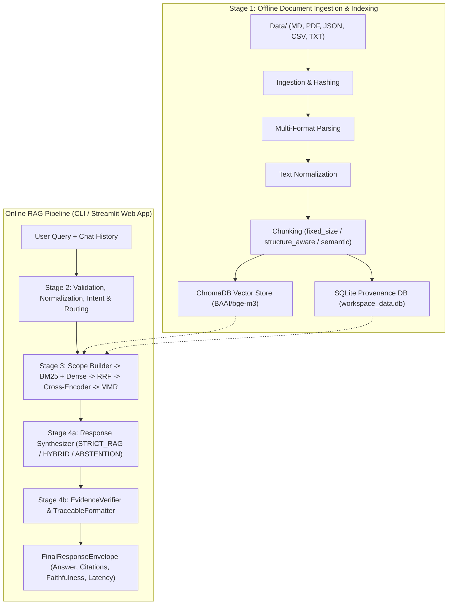

# Computational-Thinking-Project

**Intelligent Document Workspace** — A modular, bilingual (English / Vietnamese) Retrieval-Augmented Generation (RAG) system for searching, comparing, and synthesizing information security standards, cheat sheets, and structured records with **verifiable faithfulness** and **traceable source provenance**.

---

## Overview

This workspace turns heterogeneous security documentation—Markdown, PDF, JSON, CSV, and plain text—into an auditable question-answering assistant. Every answer is grounded in retrieved evidence, annotated with inline citations (`[1]`, `[2]`), linked back to exact document locators (page numbers, line ranges, CSV rows, or JSON paths), and audited by an automated faithfulness verifier.

### Key Capabilities
- **Multi-format Document Ingestion & Provenance:** Parses `.md`, `.pdf`, `.json`, `.csv`, and `.txt` files while tracking full block-to-chunk lineage in SQLite (`workspace_data.db`).
- **Multiple Chunking Strategies:** Supports `fixed_size`, `structure_aware`, and `semantic` chunking (with `semantic` as the default based on benchmark performance).
- **Query Understanding & Safety Routing:** Detects language, guards against prompt injection/out-of-scope inputs, normalizes vulnerability aliases via `ontology.yaml`, resolves multi-turn coreferences, and routes `SEARCH`, `COMPARE`, and `SYNTHESIS` intents.
- **Hybrid Retrieval + Reranking + Diversity:** Combines BM25Okapi and Dense ChromaDB (`BAAI/bge-m3`) via Reciprocal Rank Fusion (`k=60`), rescores with a Cross-Encoder (`BAAI/bge-reranker-v2-m3`) using a confidence threshold for abstention, and selects diverse evidence with Maximal Marginal Relevance (MMR).
- **Grounded Synthesis & Faithfulness Verification:** Supports `STRICT_RAG`, `HYBRID`, and `ABSTENTION` generation modes, verifies atomic claims against cited passages using a shared `BAAI/bge-m3` model, and formats traceable footnotes.
- **Dual LLM Backends & Interfaces:** Runs on either **Local Ollama** (`qwen3:4b`) or a **Remote Google Colab GPU** FastAPI server (`Qwen/Qwen3-4B` over Cloudflare Tunnel), accessible via both an interactive **CLI** (`main.py`) and a **Streamlit Web App** (`web_app.py`) with Firebase Authentication.

---

## System Architecture



---

## Tech Stack & Models

| Component | Technology / Model |
|---|---|
| Language & Runtime | Python `>= 3.10` |
| LLM Backends | `Qwen3-4B` via **Local Ollama** (`qwen3:4b`) or **Google Colab GPU** (`FastAPI_Model.ipynb` + `pycloudflared`) |
| Embedding Model | `BAAI/bge-m3` (multilingual, 1024 max tokens; shared between Retrieval & Verifier) |
| Cross-Encoder Reranker | `BAAI/bge-reranker-v2-m3` (fallback: `cross-encoder/ms-marco-MiniLM-L-6-v2`) |
| Sparse Retrieval | `rank-bm25` (`BM25Okapi`) |
| Vector & Provenance Storage | ChromaDB (HNSW cosine) + SQLite (`workspace_data.db`, `metadata.db`) |
| Document Parsing | `PyMuPDF` (PDF), `markdown-it-py` & `BeautifulSoup4` (Markdown/HTML), `csv`, `json` |
| Web UI & Authentication | Streamlit (`web_app.py`) + Firebase Authentication REST API (`firebase_client.py`) |

---

## Knowledge Corpus

- **`Data/` (50 files): 48 valid files, 1 duplicate file, and 1 empty file**
  - **46 Markdown files:** OWASP Top 10 (2021 & 2025), OWASP ASVS (v4.0 & v5.0), OWASP Cheat Sheets (A01, A03, A05, A07), and OWASP WSTG v4.2.
  - **2 PDF files:** `First_CVSS-Specification_v4.0.pdf`, `OWASP_Application-Security-Verification-Standard_5.0.0.pdf`.
  - **1 JSON file:** `First_CVSS_v4.0.json`.
  - **1 CSV file:** `OWASP_test_v1.0.csv`. -> Check the empty-file filtering mechanism

---

## Repository Structure

```text
📦 Computational-Thinking-Project/
│
├── main.py                               # Interactive CLI entry point (PipelineConnector: Stage 2 -> 3 -> 4)
├── web_app.py                            # Streamlit Web UI with Firebase Auth, backend switcher & provenance viewer
├── llm.py                                # LLM clients: ColabLLMClient (FastAPI) and OllamaLLMClient (local)
├── firebase_client.py                    # Firebase Authentication REST client (sign_in, sign_up)
├── path.py                               # Centralized project paths and chunking strategy folder mapping
├── FastAPI_Model.ipynb                   # Google Colab notebook serving Qwen/Qwen3-4B via FastAPI + Cloudflare Tunnel
├── Evaluation.json                       # 12 end-to-end evaluation test cases
├── requirements.txt                      # Full runtime Python dependencies
├── pyproject.toml                        # Stage 2 package configuration and pytest settings
├── .env.example                          # Template for Ollama, Colab, and Firebase environment variables
├── 📜 LICENSE                               # MIT License
├── 📝 README.md                             # Project documentation
│
├── 📁 Data/                                 # Primary security knowledge corpus (50 files: MD, PDF, JSON, CSV)
│
├── 📁 Document Ingestion and Parsing/       # [STAGE 1] Offline document processing and indexing
│   ├── 📁 Ingestion/                        # File discovery, SHA hashing, document & version registries
│   │   ├── Ingestion.py
│   │   ├── service.py
│   │   ├── schema_ingestion.py
│   │   └── validation.py
│   ├── 📁 Parsing/                          # Format-specific block extraction (MD, PDF, JSON, CSV, TXT)
│   │   ├── Parsing.py
│   │   ├── markdown_parser.py
│   │   ├── pdf_parser.py
│   │   ├── json_parser.py
│   │   ├── csv_parser.py
│   │   ├── txt_parser.py
│   │   ├── parser_utils.py
│   │   └── schema_parsing.py
│   ├── 📁 Normalization/                    # Unicode and whitespace cleanup
│   │   ├── Normalization.py
│   │   └── text_cleaner.py
│   ├── 📁 Chunking/                         # Multi-strategy chunking (fixed_size, structure_aware, semantic)
│   │   ├── main_chunking.py
│   │   ├── factory.py
│   │   ├── chunking.py
│   │   ├── strategy.py
│   │   ├── fixed_size.py
│   │   ├── structure_aware.py
│   │   ├── semantic.py
│   │   ├── token_counter.py
│   │   ├── schema_chunking.py
│   │   └── validation.py
│   ├── 📁 Metadata/                         # 9-field metadata extraction & ChromaDB ingestion (BAAI/bge-m3)
│   │   ├── extractor_sqlite.py
│   │   ├── schema_metadata.py
│   │   └── vector_store.py
│   ├── 📁 Provenance and Traceability/      # Block-to-chunk lineage stored in SQLite (workspace_data.db)
│   │   ├── main_provenance.py
│   │   ├── database.py
│   │   ├── provenance.py
│   │   ├── provenance_repo.py
│   │   ├── provenance_resolver.py
│   │   └── schema_provenance.py
│   └── 📁 output/                           # Generated outputs (Ingestion, Parsing, Normalization, Chunking, Provenance, Vector DB)
│
├── 📁 Query Understanding and Routing/      # [STAGE 2] Validation, normalization, intent detection & query planning
│   ├── manual_test.py                    # Manual interactive test script for Stage 2
│   └── 📁 query_understanding_routing/
│       ├── config.py                     # Stage 2 runtime configuration
│       ├── paths.py                      # Stage 2 internal path definitions
│       ├── ontology.yaml                 # Security vulnerability ontology (canonical names, aliases, CWEs)
│       ├── ontology_loader.py            # Ontology loader and cache
│       ├── llm_client.py                 # Stage 2 LLM client adapter
│       ├── validation_module.py          # Safety check & prompt injection filtering
│       ├── normalization_module.py       # Query normalization, alias mapping, language detection
│       ├── understanding_module.py       # Intent classification, entity extraction, coreference resolution
│       ├── routing_module.py             # Single-hop & multi-hop Query Plan generator
│       ├── rag_processor.py              # Query processing helper
│       ├── pipeline.py                   # Stage 2 orchestrator (process_query)
│       ├── prompt_templates.py           # LLM prompt templates for Stage 2
│       ├── 📝 PIPELINE.md                   # Stage 2 contract & testing documentation
│       ├── 📝 DEVELOPMENT.md                # Stage 2 developer notes
│       └── 📁 tests/                        # Pytest unit & integration test suite
│
├── 📁 Retrieval/                            # [STAGE 3] Hybrid retrieval, reranking, diversity & evidence assembly
│   ├── scope_builder.py                  # Metadata filters & semantic scoping
│   ├── query_vectorizer.py               # Multilingual query embeddings (BAAI/bge-m3)
│   ├── bm25_retrieval.py                 # Sparse retrieval (BM25Okapi)
│   ├── dense_retrieval.py                # Dense retrieval (ChromaDB HNSW cosine)
│   ├── rrf.py                            # Reciprocal Rank Fusion (k=60)
│   ├── reranker.py                       # Cross-Encoder reranker & confidence-threshold abstention
│   ├── MMR.py                            # Maximal Marginal Relevance diversity selection
│   ├── evidence_package.py               # Evidence packaging with [1], [2] tags and provenance locators
│   ├── ontology_utils.py                 # Ontology alias/CWE expansion for BM25
│   ├── retrieval_preparer.py             # Retrieval payload preparation
│   ├── retrieval_system.py               # RetrievalSystem facade (single-hop & multi-hop)
│   ├── schema.py                         # Retrieval data schemas
│   └── schema_reranking.py               # Reranking output schemas
│
├── 📁 Response Synthesis/                   # [STAGE 4] Grounded generation, verification & citation formatting
│   ├── prompt_templates.py               # Intent-aware prompts (SEARCH, COMPARE, SYNTHESIS) & mode directives
│   ├── synthesizer.py                    # LLM draft generation (STRICT_RAG, HYBRID, ABSTENTION)
│   ├── verifier.py                       # Atomic claim verification & faithfulness scoring (EvidenceVerifier)
│   ├── traceable_formatter.py            # Citation tag mapping & traceable footnotes (TraceableFormatter)
│   ├── schema_response.py                # Standardized output schemas (Contract v1.0)
│   ├── rag_orchestrator.py               # End-to-end orchestrator (Stage 2 -> Stage 3 -> Stage 4)
│   ├── test_synthesis_orchestration.py   # Synthesis & orchestration unit tests
│   ├── test_verification_traceability.py # Verifier & formatter unit tests
│   ├── _stage4_baseline_benchmark.py     # Deterministic Stage 4 latency benchmark
│   ├── _stage4_evaluation.py             # Stage 4 evaluation harness
│   └── 📝 README.md                         # Detailed Stage 4 architecture & contract docs
│
├── 📁 Evaluation/                           # Evaluation suites (Chunking, Retrieval, and End-to-End RAG)
│   ├── scripts.py                        # Shared evaluation helper scripts
│   ├── 📁 Chunking Evals/                   # Layer 1 intrinsic & Layer 2 retrieval chunking benchmarks
│   │   ├── evals_layer1.py
│   │   ├── evals_layer2.py
│   │   ├── build_chunking_gt.py
│   │   ├── doc_offset.py
│   │   ├── 📋 eval_layer1_report.json
│   │   ├── 📋 eval_layer2_report.json
│   │   ├── Eval-chunking-colab.ipynb
│   │   └── Eval_E2E.ipynb
│   ├── 📁 Retrieval Evals/                  # Stage 3 retrieval evaluation dataset, scripts & Colab notebook
│   │   ├── eval_retrieval.py
│   │   ├── pack_eval_retrieval.py
│   │   ├── 📋 retrieval_eval_dataset.json
│   │   ├── 📋 retrieval_eval_report.json
│   │   └── Eval_retrieval_colab.ipynb
│   └── 📁 End-to-end RAG Evals/             # Full-pipeline task, generation & performance evaluation
│       ├── eval_e2e.py
│       ├── pack_eval_e2e.py
│       ├── Eval_E2E_colab.ipynb
│       ├── 📁 evaluators/
│       └── 📁 reports/
│
├── 📁 evaluations/                          # Stage 4 evaluation templates (R9C)
│   └── 📝 r9c/REPORT_TEMPLATE.md
│
└── 📁 Utilize Colab/                        # Helper scripts & notebooks to offload preprocessing/evals to Colab GPU
    ├── Data_Preprocessing.ipynb
    ├── colab.py
    └── pack_eval_chunking.py
```

---

## Getting Started

### 1. Prerequisites
- **Python 3.10+**
- At least one LLM backend:
  - **Local Ollama** with `qwen3:4b` pulled, **or**
  - **Google Colab (GPU)** running `FastAPI_Model.ipynb`
- *(Optional, for `web_app.py`)* A **Firebase** project with Email/Password Authentication enabled.

### 2. Installation

Clone the repository and create a virtual environment:

```bash
git clone <repository-url>
cd Computational-Thinking-Project
python -m venv .venv
```

Activate the virtual environment:
- **Windows (PowerShell):** `.venv\Scripts\Activate.ps1`
- **macOS / Linux:** `source .venv/bin/activate`

Install the Stage 2 package in editable mode and the core runtime dependencies:

```bash
python -m pip install -e .
python -m pip install torch sentence-transformers chromadb rank-bm25 langchain-community \
    pymupdf markdown-it-py beautifulsoup4 requests python-dotenv streamlit pytest
```

> **Note:** `pyproject.toml` packages the Stage 2 (`query_understanding_routing`) module and its direct dependency (`PyYAML==6.0.3`); the additional packages above are required for Stage 1, Stage 3, Stage 4, and the Streamlit UI.

### 3. Environment Configuration

Copy `.env.example` to `.env` and fill in the relevant values:

```env
OLLAMA_HOST=http://localhost:11434
COLAB_API_URL=https://<your-cloudflare-tunnel-url>

# Required only for Streamlit Web App (web_app.py) authentication
FIREBASE_API_KEY=
FIREBASE_AUTH_DOMAIN=
FIREBASE_PROJECT_ID=
FIREBASE_STORAGE_BUCKET=
FIREBASE_MESSAGING_SENDER_ID=
FIREBASE_APP_ID=
```

### 4. Configure an LLM Backend

- **Option A — Local Ollama:**
  ```bash
  ollama pull qwen3:4b
  ollama serve
  ```
- **Option B — Remote Google Colab GPU:**
  1. Open `FastAPI_Model.ipynb` in Google Colab with a GPU runtime and run all cells.
  2. Copy the printed Cloudflare Tunnel URL (`https://...trycloudflare.com`) into `COLAB_API_URL` in `.env` (or paste it directly into the Streamlit sidebar).

---

## Usage

### Run the Streamlit Web App (Recommended)

```bash
streamlit run web_app.py
```

Features in the web interface:
- Sign up / sign in via Firebase Auth.
- Switch between **Local Ollama** and **Remote Colab GPU (FastAPI)** in the sidebar.
- Inspect per-query **Intent**, **Faithfulness score**, **stage-by-stage Latency**, **rewritten multi-turn query**, and expandable **Referenced Sources & Provenance**.

### Run the Interactive CLI

```bash
python main.py
```

CLI commands:
- Type any security question in English or Vietnamese and press Enter.
- Type `reset`, `clear`, or `refresh` to clear conversation memory.
- Type `exit`, `quit`, or `q` to quit.

> **Note:** `main.py` defaults to `chunking_strategy="semantic"` and `ColabLLMClient()`. To use local Ollama in the CLI, pass `llm_client=local_llm` to `PipelineConnector` in `main.py`.

### Rebuild Stage 1 Indexes (Optional)

Prebuilt outputs live under `Document Ingestion and Parsing/output/`. To regenerate them from `Data/`:

1. Run Stage 1 steps sequentially (`Ingestion.py` → `Parsing.py` → `Normalization.py` → `main_chunking.py` → `main_provenance.py` → `vector_store.py`), **or**
2. Use `Utilize Colab/colab.py` + `Utilize Colab/Data_Preprocessing.ipynb` to run semantic chunking and BGE-M3 embedding generation on a Colab GPU.

---

## Deployment

We have tested a deployment, but the deployment configuration and scripts (developed in a separate test environment) have not been committed to `main` yet, and the temporary Vast.ai GPU instance has been torn down after end-to-end verification to avoid ongoing rental costs—so no live public URL is currently hosted.

### Vast.ai GPU Demo Summary

The full pipeline was deployed and verified end-to-end on a single **Vast.ai GPU container** (**NVIDIA Quadro RTX 6000**):

- **Runtime & Environment:** Python 3.12 virtual environment managed via `uv` with CUDA-enabled PyTorch and prefetched `BAAI/bge-m3` and `BAAI/bge-reranker-v2-m3` weights.
- **LLM Backend:** Local Ollama (`127.0.0.1:11434`) serving `qwen3:4b-instruct` instead of the default `qwen3:4b` tag (whose `Thinking-2507` variant ignored `think=false` and leaked reasoning traces, dropping faithfulness to ~59%). With `qwen3:4b-instruct`, end-to-end responses achieved **75–82% faithfulness** at **~45–84 s** per query (including ~37.7 s for CPU-bound verifier inference).
- **Web UI, Auth & Exposure:** Streamlit (`web_app.py` on `127.0.0.1:8501`) using local bcrypt-backed accounts (`streamlit-authenticator`) as a lightweight alternative to Firebase Auth, exposed publicly over HTTPS via a **Cloudflare Quick Tunnel** (`cloudflared` → `https://*.trycloudflare.com`).
- **Automated Lifecycle Scripts (unmerged prototype):** Provisioning and service management were scripted into `setup.sh` (environment, Ollama, `cloudflared`, and model prefetching), `start.sh` (starts Ollama, Streamlit, and the tunnel), and `stop.sh` (PID-based teardown).

---

## Running Tests

### Stage 2 — Query Understanding & Routing (`pytest`)

```bash
# Unit tests
python -m pytest

# Full suite including integration tests
REQUIRE_INTEGRATION=1 python -m pytest
```

On Windows PowerShell:
```powershell
$env:REQUIRE_INTEGRATION="1"; python -m pytest -q -rs; Remove-Item Env:REQUIRE_INTEGRATION
```

### Stage 4 — Synthesis, Verification & Traceability (`unittest`)

```bash
cd "Response Synthesis"
python -m unittest test_verification_traceability test_synthesis_orchestration
```

---

## Additional Documentation

- **Stage 2 Contract & Pipeline Guide:** [`Query Understanding and Routing/query_understanding_routing/PIPELINE.md`](Query%20Understanding%20and%20Routing/query_understanding_routing/PIPELINE.md)
- **Stage 4 Architecture & Verification Details:** [`Response Synthesis/README.md`](Response%20Synthesis/README.md)

---

## License

This project is licensed under the **MIT License** — see the [`LICENSE`](LICENSE) file for details.
