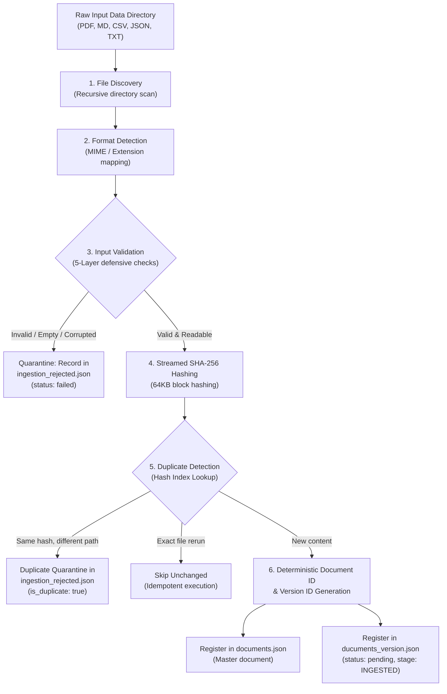

# Clarification & Architectural Specification: Data Ingestion Pipeline (Stage 1)

> **Course**: CSC10014 — Computational Thinking (FIT - HCMUS, 2026)  
> **Topic Track**: Track C — Intelligent Document Workspace  
> **Sub-Task**: Stage 1 — Data Ingestion & Validation (`data_ingestion`)  
> **Stage Assignee**: **Long**  
> **References**:  
> - Specification Note: [`Note-Computational-Thinking.pdf`](file:///D:/computational_thinking/Computational-Thinking-Project/Note-Computational-Thinking.pdf) (Pages 2–3, 10–11)  
> - Canonical Output Directory: [`Document Ingestion and Parsing/output/Ingestion/`](file:///D:/computational_thinking/Computational-Thinking-Project/Document%20Ingestion%20and%20Parsing/output/Ingestion)  
> - Source Implementations: [`long_nguyen/src/pipeline/ingestion.py`](file:///D:/computational_thinking/Computational-Thinking-Project/long_nguyen/src/pipeline/ingestion.py) & [`Document Ingestion and Parsing/Ingestion/`](file:///D:/computational_thinking/Computational-Thinking-Project/Document%20Ingestion%20and%20Parsing/Ingestion)

---

## 1. Executive Summary & Computational Thinking Pillars

Stage 1 (**Data Ingestion & Validation**) serves as the deterministic gatekeeper of the entire Intelligent Document Workspace. Ingestion ensures that unvalidated, empty, corrupted, or duplicated files never enter downstream stages (Stage 2 Parsing, Stage 3 Normalization, Stage 4 Chunking, Stage 5 Metadata Extraction, Stage 6 Traceability).



### The 4 Pillars of Computational Thinking Applied to Stage 1:

1. **Decomposition**:
   The task is partitioned into 7 modular sub-tasks (as outlined in `Note-Computational-Thinking.pdf`, page 2):
   - **File Discovery**: Recursively enumerating files while ignoring hidden files (`.git`, `.DS_Store`).
   - **Format Detection**: Whitelisting and identifying formats (`PDF`, `MARKDOWN`, `CSV`, `JSON`, `TXT`).
   - **Input Validation**: Verifying existence, read permissions, non-emptiness ($>0$ bytes), size ceilings ($\le 50\text{ MB}$), and magic bytes/UTF-8 decode integrity.
   - **Document Identification**: Deterministic canonical slug generation (`doc_{publisher}_{topic}`).
   - **Duplicate Detection**: Fast $O(1)$ collision detection using 64-character SHA-256 hex digests.
   - **Processing Status Lifecycle**: Managing state transitions (`pending` $\rightarrow$ `processing` $\rightarrow$ `success` / `failed`).
   - **Defensive Error Handling**: Non-fatal exception handling, logging exact error causes in quarantine.

2. **Pattern Recognition**:
   - **File Naming Standard**: `{Publisher}_{Topic}_{Version/Year}.{ext}` (e.g., `OWASP_Top10-A01-Broken-Access-Control_2025.md`, `First_CVSS-Specification_v4.0.pdf`).
   - **Content Hashes**: Content identity is independent of file name; identical files across different paths share identical SHA-256 hashes.
   - **Magic Signatures**: PDF header must begin with `%PDF-`; Markdown/JSON/CSV/TXT must be decodable as valid UTF-8.

3. **Abstraction**:
   - **Decoupling Master Document vs Document Version**: A master document represents an ongoing work (e.g., *OWASP Top 10 A01*), while versions represent specific revisions/snapshots (e.g., *2025 edition* vs *2021 edition*).
   - **Data Transfer Objects (DTOs)**: Enforcing strict dataclass schemas (`DocumentSchema`, `DocumentVersionSchema`).

4. **Algorithm Design**:
   - Linear-time $O(N)$ single-pass ingestion algorithm with $O(1)$ hash index lookups.
   - Idempotent execution: Running the pipeline multiple times does not produce duplicate records or modify unchanged files.

---

## 2. Clarification: Old Version (`src`) vs Standardized Canonical Format

### Why the Old Version in `src` Returned the Wrong JSON Format

In early prototype iterations ([`long_nguyen/src/pipeline/ingestion.py`](file:///D:/computational_thinking/Computational-Thinking-Project/long_nguyen/src/pipeline/ingestion.py)), ingestion dumped raw SQLite tables (`workspace.db`) into a single file [`workspace.json`](file:///D:/computational_thinking/Computational-Thinking-Project/long_nguyen/exp/1.md) via [`export_all_to_json.py`](file:///D:/computational_thinking/Computational-Thinking-Project/long_nguyen/src/export_all_to_json.py). This had four major structural shortcomings:

1. **Monolithic Dumping**: Everything was exported into a single object `{"documents": [...], "document_versions": [...]}` rather than decoupled, modular pipeline manifests.
2. **Non-Deterministic Random UUIDs**: `document_id` was created using `doc_` + random UUID (`doc_f47ac10b`), making it impossible for Stage 2 Parsers and downstream stages to establish stable document identity across re-runs.
3. **Missing Canonical Fields**:
   - Did not distinguish `canonical_title` and `publisher`.
   - Did not store `version_tag` (e.g., `v4.0`, `2025`), storing only an integer `version_number`.
   - Did not track `current_stage` (e.g., `INGESTED` vs `INGESTION`).
   - Did not flag `is_duplicate`.
4. **Missing Ingestion Quarantine (`ingestion_rejected.json`)**: Failed or corrupt files were either silently skipped or dumped alongside valid records, which broke downstream parsers expecting valid file paths and hashes.

### The Correct Canonical Format ([`Document Ingestion and Parsing/output/Ingestion/`](file:///D:/computational_thinking/Computational-Thinking-Project/Document%20Ingestion%20and%20Parsing/output/Ingestion))

The standardized architecture separates ingestion outputs into **3 distinct JSON manifests**:
1. [`documents.json`](file:///D:/computational_thinking/Computational-Thinking-Project/Document%20Ingestion%20and%20Parsing/output/Ingestion/documents.json): Registry of master document entities.
2. [`ducuments_version.json`](file:///D:/computational_thinking/Computational-Thinking-Project/Document%20Ingestion%20and%20Parsing/output/Ingestion/ducuments_version.json): Validated, staged revisions ready for Stage 2 Parsing (`status: pending`, `current_stage: INGESTED`).
3. [`ingestion_rejected.json`](file:///D:/computational_thinking/Computational-Thinking-Project/Document%20Ingestion%20and%20Parsing/output/Ingestion/ingestion_rejected.json): Audit log of all rejected, empty, corrupted, or duplicated files with explicit `error_message`.

### Side-by-Side Schema Comparison Matrix

| Property | Old Prototype (`src` / SQLite dump) | Canonical Pipeline (`output/Ingestion/`) | Impact & Rationale |
| :--- | :--- | :--- | :--- |
| **Output Storage** | Single monolithic `workspace.json` | 3 distinct JSON files (`documents`, `ducuments_version`, `ingestion_rejected`) | Loose coupling; Stage 2 parsers only ingest validated files. |
| **Document ID** | Random hex: `doc_8e3c12a0` | Deterministic clean slug: `doc_owasp_top10_a01_broken_access_control` | Idempotent, human-readable, cross-stage linking. |
| **Document Title** | Field: `name` | Field: `canonical_title` (e.g. `OWASP - Top10-A01-Broken-Access-Control`) | Matches official project ontology. |
| **Publisher** | Merged in `domain_category` (`general`) | Dedicated field: `publisher` (`OWASP`, `First`, `NIST`) | Enables publisher-based taxonomy routing. |
| **Version ID** | `ver_doc_uuid_v1` | `ver_{sha256[:12]}` (e.g. `ver_77afde9ea09f`) | Content-derived, tamper-evident version ID. |
| **Version Label** | Numeric: `version_number: 1` | Semantic tag: `version_tag: "v4.0"` / `"2025"` | Reflects real release tags from source filenames. |
| **File Path** | Local absolute Windows path `D:\...` | Normalized POSIX relative path: `Data/OWASP_...md` | Cross-platform compatibility (Linux, macOS, Windows). |
| **Format Case** | Lowercase extension (`md`, `pdf`) | Standardized uppercase Enum: `MARKDOWN`, `PDF`, `CSV`, `JSON`, `TXT` | Conforms to Course Specification. |
| **Pipeline Stage** | Missing | Explicit: `current_stage: "INGESTED"` | Allows pipeline orchestrators to track progression. |
| **Duplicates** | Skipped from DB without tracking | Persisted in `ingestion_rejected.json` with `is_duplicate: true` | Complete audit trail for pentest & compliance reports. |
| **Error Cause** | Basic string | Detailed error message in `ingestion_rejected.json` | Immediate feedback on why a file failed. |

---

## 3. Coded Architecture & Component Breakdown

The codebase is structured into cohesive, single-responsibility modules:

```
Document Ingestion and Parsing/
├── path.py                     # Centralized path anchors & POSIX path resolvers
├── Ingestion/
│   ├── Ingestion.py            # CLI entry point with safe UTF-8 terminal reporting
│   ├── schema_ingestion.py     # Strongly typed Dataclasses & Enums
│   ├── validation.py           # 5-layer defensive file validator
│   └── service.py              # IngestionService coordinator & Hasher
└── output/
    └── Ingestion/
        ├── documents.json            # Master document records
        ├── ducuments_version.json    # Validated versions ready for Parsing
        └── ingestion_rejected.json   # Quarantine & error audit trail

long_nguyen/src/pipeline/
└── ingestion.py                # Unified production pipeline module
```

### 3.1 [`path.py`](file:///D:/computational_thinking/Computational-Thinking-Project/Document%20Ingestion%20and%20Parsing/path.py): Centralized Path Management
- [`PIPELINE_DIR`](file:///D:/computational_thinking/Computational-Thinking-Project/Document%20Ingestion%20and%20Parsing/path.py#L7): Root of pipeline stages.
- [`PROJECT_ROOT`](file:///D:/computational_thinking/Computational-Thinking-Project/Document%20Ingestion%20and%20Parsing/path.py#L8): Base workspace anchor.
- [`to_relative_posix(path)`](file:///D:/computational_thinking/Computational-Thinking-Project/Document%20Ingestion%20and%20Parsing/path.py#L22-L32): Converts OS-specific absolute paths into portable POSIX relative paths (e.g. `Data/First_CVSS_v4.0.json`).
- [`to_actual_path(rel_posix_path)`](file:///D:/computational_thinking/Computational-Thinking-Project/Document%20Ingestion%20and%20Parsing/path.py#L34-L41): Safely resolves JSON path strings into OS filesystem `Path` objects.

### 3.2 [`schema_ingestion.py`](file:///D:/computational_thinking/Computational-Thinking-Project/Document%20Ingestion%20and%20Parsing/Ingestion/schema_ingestion.py): Data Schemas & Enums
- [`FileFormat`](file:///D:/computational_thinking/Computational-Thinking-Project/Document%20Ingestion%20and%20Parsing/Ingestion/schema_ingestion.py#L6-L12): `PDF`, `MARKDOWN`, `CSV`, `JSON`, `TXT`, `UNKNOWN`.
- [`ProcessingStatus`](file:///D:/computational_thinking/Computational-Thinking-Project/Document%20Ingestion%20and%20Parsing/Ingestion/schema_ingestion.py#L15-L19): `pending`, `processing`, `success`, `failed`.
- [`DocumentSchema`](file:///D:/computational_thinking/Computational-Thinking-Project/Document%20Ingestion%20and%20Parsing/Ingestion/schema_ingestion.py#L22-L33): Master record with `document_id`, `canonical_title`, `publisher`, `created_at`.
- [`DocumentVersionSchema`](file:///D:/computational_thinking/Computational-Thinking-Project/Document%20Ingestion%20and%20Parsing/Ingestion/schema_ingestion.py#L35-L54): Complete version tracking record.

### 3.3 [`validation.py`](file:///D:/computational_thinking/Computational-Thinking-Project/Document%20Ingestion%20and%20Parsing/Ingestion/validation.py): [`FileValidator`](file:///D:/computational_thinking/Computational-Thinking-Project/Document%20Ingestion%20and%20Parsing/Ingestion/validation.py#L7-L68) (5-Layer Defensive Check)
1. **Physical Existence**: Rejects non-existent paths and directories.
2. **Read Permission**: Verifies `os.access(file_path, os.R_OK)`.
3. **Format Whitelist**: Rejects unsupported extensions with `Unsupported file format`.
4. **Empty Check & Size Ceiling**: Rejects 0-byte files (`File is empty (0 bytes).`) and files exceeding 50MB.
5. **Magic Header & Character Stream Verification**:
   - For PDF: Reads the first 5 bytes, verifying `%PDF-` signature.
   - For Text/Markdown/JSON/CSV: Validates UTF-8 decodability and ensures content is not purely whitespace.

### 3.4 [`service.py`](file:///D:/computational_thinking/Computational-Thinking-Project/Document%20Ingestion%20and%20Parsing/Ingestion/service.py): [`IngestionService`](file:///D:/computational_thinking/Computational-Thinking-Project/Document%20Ingestion%20and%20Parsing/Ingestion/service.py#L32-L237) & [`Hasher`](file:///D:/computational_thinking/Computational-Thinking-Project/Document%20Ingestion%20and%20Parsing/Ingestion/service.py#L20-L29)
- [`Hasher.compute_sha256`](file:///D:/computational_thinking/Computational-Thinking-Project/Document%20Ingestion%20and%20Parsing/Ingestion/service.py#L24-L29): Calculates SHA-256 in 64KB chunks to protect RAM.
- [`discover_files()`](file:///D:/computational_thinking/Computational-Thinking-Project/Document%20Ingestion%20and%20Parsing/Ingestion/service.py#L66-L73): Recursively discovers files in `Data/`.
- [`_parse_filename()`](file:///D:/computational_thinking/Computational-Thinking-Project/Document%20Ingestion%20and%20Parsing/Ingestion/service.py#L75-L105): Parses `{Publisher}_{Topic}_{Version}` into clean slugs and metadata.
- [`ingest_file()`](file:///D:/computational_thinking/Computational-Thinking-Project/Document%20Ingestion%20and%20Parsing/Ingestion/service.py#L107-L203): Dispatches validation, hashing, duplicate check, and schema creation.
- [`save_outputs()`](file:///D:/computational_thinking/Computational-Thinking-Project/Document%20Ingestion%20and%20Parsing/Ingestion/service.py#L229-L237): Atomically writes `documents.json`, `ducuments_version.json`, and `ingestion_rejected.json`.

### 3.5 [`long_nguyen/src/pipeline/ingestion.py`](file:///D:/computational_thinking/Computational-Thinking-Project/long_nguyen/src/pipeline/ingestion.py): Unified Ingestion Engine
Updated to provide:
1. Canonical [`IngestionService`](file:///D:/computational_thinking/Computational-Thinking-Project/long_nguyen/src/pipeline/ingestion.py#L173-L337) producing the official 3 JSON files.
2. Backwards-compatible [`DataIngestionPipeline`](file:///D:/computational_thinking/Computational-Thinking-Project/long_nguyen/src/pipeline/ingestion.py#L343-L525) supporting SQLite operations, unit tests, and JSON export.
3. Windows UTF-8 stdout configuration preventing console encoding crashes (`UnicodeEncodeError`).

---

## 4. Ground Truth JSON Output Specifications

### 4.1 Master Documents Manifest: `documents.json`
Stores unique document entities that persist across multiple versions.

```json
[
  {
    "document_id": "doc_first_cvss_specification",
    "canonical_title": "First - CVSS-Specification",
    "publisher": "First",
    "created_at": "2026-10-17T07:51:56.844441+00:00"
  },
  {
    "document_id": "doc_first_cvss",
    "canonical_title": "First - CVSS",
    "publisher": "First",
    "created_at": "2026-10-17T07:51:56.885497+00:00"
  },
  {
    "document_id": "doc_owasp_application_security_verification_standard",
    "canonical_title": "OWASP - Application-Security-Verification-Standard",
    "publisher": "OWASP",
    "created_at": "2026-10-17T07:51:56.926592+00:00"
  },
  {
    "document_id": "doc_owasp_top10_a01_broken_access_control",
    "canonical_title": "OWASP - Top10-A01-Broken-Access-Control",
    "publisher": "OWASP",
    "created_at": "2026-10-17T07:51:56.989300+00:00"
  }
]
```

### 4.2 Document Versions Manifest: `ducuments_version.json`
Stores all successfully validated document versions queued for Stage 2 Parsing (`status: pending`, `current_stage: INGESTED`).

```json
[
  {
    "version_id": "ver_77afde9ea09f",
    "document_id": "doc_first_cvss_specification",
    "version_tag": "v4.0",
    "file_name": "First_CVSS-Specification_v4.0.pdf",
    "file_path": "Data/First_CVSS-Specification_v4.0.pdf",
    "file_format": "PDF",
    "file_size_bytes": 1143820,
    "sha256_hash": "77afde9ea09f8a5ce2ba59733082964e777cab77dd786fb5e4e258aefa0dbc40",
    "status": "pending",
    "current_stage": "INGESTED",
    "is_duplicate": false,
    "error_message": null,
    "updated_at": "2026-10-17T07:51:56.844441+00:00"
  },
  {
    "version_id": "ver_04040e0917f5",
    "document_id": "doc_first_cvss",
    "version_tag": "v4.0",
    "file_name": "First_CVSS_v4.0.json",
    "file_path": "Data/First_CVSS_v4.0.json",
    "file_format": "JSON",
    "file_size_bytes": 11312,
    "sha256_hash": "04040e0917f5b9162e529ca9cac8d69e42ec80b0cd2e2cdcbc004fe391f8c92c",
    "status": "pending",
    "current_stage": "INGESTED",
    "is_duplicate": false,
    "error_message": null,
    "updated_at": "2026-10-17T07:51:56.885497+00:00"
  },
  {
    "version_id": "ver_d6ebc4e65422",
    "document_id": "doc_owasp_top10_a01_broken_access_control",
    "version_tag": "2025",
    "file_name": "OWASP_Top10-A01-Broken-Access-Control_2025.md",
    "file_path": "Data/OWASP_Top10-A01-Broken-Access-Control_2025.md",
    "file_format": "MARKDOWN",
    "file_size_bytes": 10383,
    "sha256_hash": "d6ebc4e65422ff4fa32c310dec3c20ed6e804edfd2d06c7e5b8a802645f556ec",
    "status": "pending",
    "current_stage": "INGESTED",
    "is_duplicate": false,
    "error_message": null,
    "updated_at": "2026-10-17T07:51:56.989300+00:00"
  }
]
```

### 4.3 Ingestion Quarantine Manifest: `ingestion_rejected.json`
Stores records of all rejected files (0 bytes, unsupported format, corrupted header, or duplicate content).

```json
[
  {
    "version_id": "ver_failed_84e87fb6",
    "document_id": "doc_owasp_test",
    "version_tag": "v1.0",
    "file_name": "OWASP_test_v1.0.csv",
    "file_path": "Data/OWASP_test_v1.0.csv",
    "file_format": "CSV",
    "file_size_bytes": 0,
    "sha256_hash": null,
    "status": "failed",
    "current_stage": "INGESTION",
    "is_duplicate": false,
    "error_message": "File is empty (0 bytes).",
    "updated_at": "2026-10-17T07:51:56.926592+00:00"
  }
]
```

---

## 5. Execution Guide & Verification Evidence

### 5.1 How to Execute the Pipeline

#### Method A: Direct Execution via Canonical Entry Point
```powershell
python "Document Ingestion and Parsing/Ingestion/Ingestion.py"
```

#### Method B: Execution via `long_nguyen` Unified Ingestion Module
```powershell
py long_nguyen/src/pipeline/ingestion.py
```

### 5.2 Actual Execution Output on `Data/`
```text
=== KẾT QUẢ CHẠY BƯỚC 1: DOCUMENT INGESTION ===
- Thư mục Data quét          : D:\computational_thinking\Computational-Thinking-Project\Data
- Tổng số file quét được     : 8
- File mới nạp (New)         : 0
- File đã có, bỏ qua (Skip)  : 7
- File trùng nội dung (Dup)  : 0
- File lỗi (Failed)          : 1
=> Đã lưu Output tại         : D:\computational_thinking\Computational-Thinking-Project\Document Ingestion and Parsing\output\Ingestion
```

### 5.3 Automated Unit Test Verification (Pytest)
Run the automated test suite covering discovery, validation, SHA-256 deduplication, state transitions, and JSON manifest generation:

```powershell
py -m pytest long_nguyen/tests/test_ingestion.py -v
```

**Test Execution Results**:
```text
============================= test session starts =============================
platform win32 -- Python 3.14.3, pytest-9.1.1, pluggy-1.7.0
rootdir: D:\computational_thinking\Computational-Thinking-Project
collected 6 items

long_nguyen/tests/test_ingestion.py::test_file_discovery PASSED          [ 16%]
long_nguyen/tests/test_ingestion.py::test_valid_ingestion PASSED         [ 33%]
long_nguyen/tests/test_ingestion.py::test_duplicate_detection PASSED     [ 50%]
long_nguyen/tests/test_ingestion.py::test_empty_file_rejection PASSED    [ 66%]
long_nguyen/tests/test_ingestion.py::test_status_lifecycle_updates PASSED [ 83%]
long_nguyen/tests/test_ingestion.py::test_ingestion_service_json_manifests PASSED [100%]

============================== 6 passed in 0.34s ==============================
```
